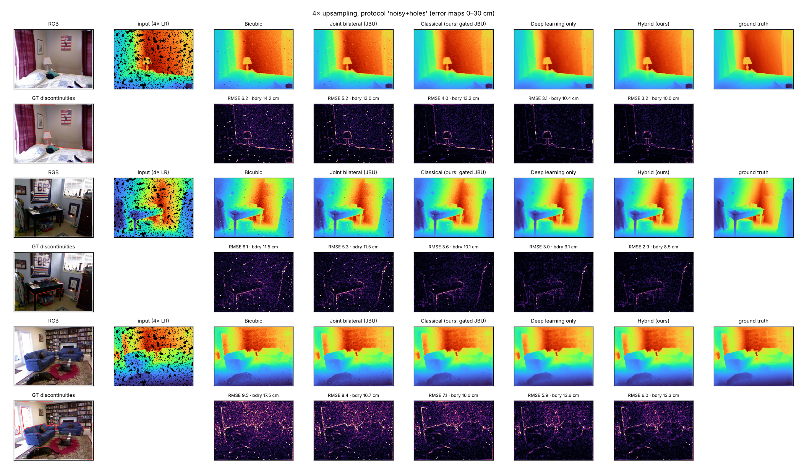

# EdgeGate: edge-preserving depth map upsampling (Computer Vision Hackathon 2026, problem P4)

Turns sparse or low-resolution depth (2x / 4x / 8x, with noise and missing values) into dense high-resolution depth, using RGB guidance **without copying RGB texture into depth**.

**Approach in one paragraph.** A classical stage cleans the depth (hole filling, spike removal, noise-adaptive smoothing), detects *depth discontinuities* with a step detector, and lets RGB influence the result **only near those discontinuities** (a gated, tri-lateral joint bilateral upsampling). A small U-Net (0.22 M parameters) then predicts a residual and a per-pixel blend β between the safe bicubic estimate and the sharp classical one: `out = E0 + β (E1 − E0) + δ`. Because β = 0 gives the same form as the deep-only model (bicubic plus a learned residual), the hybrid can represent that solution; training does not guarantee it matches it (on clean input the small hybrid ended slightly worse). An **Auto** selector uses the deep-only model for pristine input and the hybrid for noisy or incomplete input.

## Results (NYU Depth V2, held-out test frames; RMSE in cm, lower is better)

| Condition | Bicubic | Joint bilateral | Classical (ours) | Deep only (small) | Hybrid v2 (small) | Auto (small) | Deep only-L (GPU) |
|---|---|---|---|---|---|---|---|
| clean, 2x (n=449) | 2.56 | 2.60 | 2.86 | 1.76 | 1.75 | 1.76 | **0.95** |
| clean, 4x (n=449) | 4.61 | 4.47 | 4.77 | 2.77 | 2.92 | 2.77 | **1.69** |
| clean, 8x (n=449) | 7.69 | 7.49 | 7.69 | 4.98 | 5.17 | 5.00 | **3.43** |
| noisy, 2x (n=150) | 6.71 | 5.50 | 4.06 | 2.51 | 2.54 | 2.54 | **1.88** |
| noisy, 4x (n=150) | 7.53 | 6.41 | 5.33 | 3.71 | 3.64 | 3.64 | **2.77** |
| noisy, 8x (n=150) | 9.20 | 8.30 | 7.57 | 5.70 | 5.73 | 5.73 | **4.35** |
| noisy+holes, 2x (n=150) | 7.52 | 6.30 | 4.65 | 3.61 | 3.18 | 3.18 | **2.48** |
| noisy+holes, 4x (n=150) | 8.90 | 7.75 | 6.37 | 5.48 | 4.72 | 4.72 | **3.82** |
| noisy+holes, 8x (n=150) | 11.31 | 10.23 | 9.13 | 8.21 | 7.58 | 7.58 | **6.11** |

* All numbers come from `results/` and are reproduced by `scripts/reproduce.sh`; full metrics (MAE, PSNR, SSIM, boundary RMSE, edge F1, texture-copy RMSE, latency, memory, paired bootstrap CIs) are in **`eval_P4_T19.md`**.
* **Best arm per protocol (generated from the table):** `clean`: Deep only-L (GPU) best at 3/3 scales; `noisy`: Deep only-L (GPU) best at 3/3 scales; `noisy+holes`: Deep only-L (GPU) best at 3/3 scales.
* **Large GPU-trained deep-only model (`dl_only_L`, about 9 M parameters, 12,350 steps, batch 16, 256 px crops, bf16 + EMA, trained on frames 0-949):** it has the lowest RMSE and boundary RMSE in every protocol and scale, e.g. 31% lower RMSE than the small deep-only model at clean 8x and 30% lower at noisy+holes 4x. **A large hybrid (`hybrid_L`) was not trained for lack of time**, so whether the classical features help a *large* model is untested; the only evidence on that question is at small-model scale (next bullet).
* **Small CPU-trained models (0.22 M parameters):** every learned arm is far better than interpolation. On pristine input the deep-only model is marginally better than the hybrid at 4x and 8x; with noise and missing values the hybrid is clearly better (by 8 to 14% RMSE). The classical stage alone sharpens boundaries (edge F1 0.76 vs 0.45 at 8x) but does not reduce RMSE on clean input. Details and negative results: `docs/ABLATION.md`, `docs/FAILURES.md`.
* Latency, 480x640, 4x, 4 CPU threads, median (measured on the GPU laptop's CPU; a free 2-vCPU host will be slower): bicubic 1 ms, classical 323 ms, deep-only (small) 99 ms, hybrid (small) 430 ms, **deep-only-L 2585 ms**. Model files: small about 0.86 MB each, large about 36 MB. Peak-memory figures in `eval_P4_*.md` come from a Windows counter and are not comparable with earlier Linux runs.
* Depth units are *assumed* (raw x 10 m); only relative comparisons between methods are meaningful in absolute terms.



## Run it

```bash
pip install -r requirements.txt            # CPU is enough (use requirements-dev.txt to also reproduce experiments / run tests)
streamlit run app.py                       # http://localhost:8501  (weights and sample frames are in the repo)
```
or `docker build -t edgegate . && docker run -p 8501:8501 edgegate`.

The app has two modes: **simulate** (RGB + dense depth: it degrades the depth and compares every method against ground truth) and **upsample my depth** (RGB + low-resolution depth, no ground truth). Accepted depth: `.npy`/`.npz` (metres), 16-bit PNG (mm), 8-bit PNG (relative, rescaled to 0.5-5 m). Bad files give a readable error, not a stack trace. A depth map is required: depth is not estimated from RGB alone.

## Reproduce the numbers
1. Download the NYU Depth V2 labelled set used here (`xcll/nyu_depth_train_float32_1449` on Hugging Face), unzip to `data/nyu/`.
2. `bash scripts/reproduce.sh` (about 2 h on 4 CPU cores): builds the cache, trains both models (35 min each), evaluates every method, runs ablations, efficiency benchmark and failure mining, regenerates `eval_P4_*.md` and figures. Set `TEAM` and `USNS` environment variables for the eval file header.
3. `python -m pytest -q tests` runs 17 fast unit tests (no dataset needed).

## Repository map
| Path | Purpose |
|---|---|
| `depthup/classical.py` | interpolation, hole filling, spike/noise handling, JBU, guided filter, discontinuity detector, gate, colour-plateau snap |
| `depthup/model.py`, `pipeline.py` | networks and the comparison arms (`METHODS`) |
| `depthup/train.py`, `evaluate.py`, `ablate.py`, `benchmark.py`, `failures.py`, `report.py` | training and every experiment |
| `depthup/io.py` | validated loading of user uploads |
| `app.py`, `Dockerfile`, `.streamlit/` | web app and deployment |
| `docs/architecture.png`, `DESIGN.md`, `ABLATION.md`, `FAILURES.md` | architecture and design documentation |
| `eval_P4_T19.md` | comparative evaluation |

## Data, ethics and limitations
Data split: the small models trained on frames 0-799 and validated on 800-999; the large model trained on 0-949 and validated on 950-999; **frames 1000-1448 (test) were never used for training, validation or tuning by any model**. NYU Depth V2 is licensed for research use; the six sample frames in `samples/` are test-split frames included for the demo. The model was trained on indoor Kinect scenes only and is untested on outdoor, LiDAR or real low-resolution ToF data; the corruption model is synthetic. Depth upsampling output must not be treated as a measurement in safety-critical settings: reconstructed boundaries are estimates, and thin structures narrower than one low-resolution cell are not recoverable (see `docs/FAILURES.md`).
