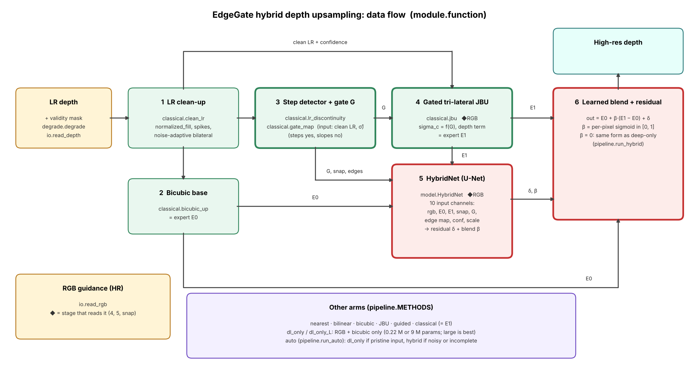
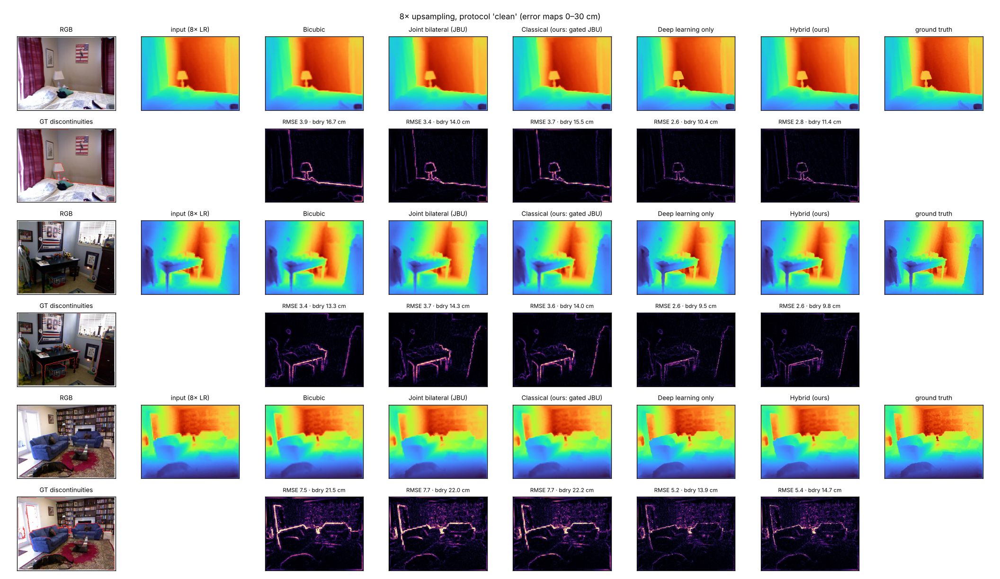
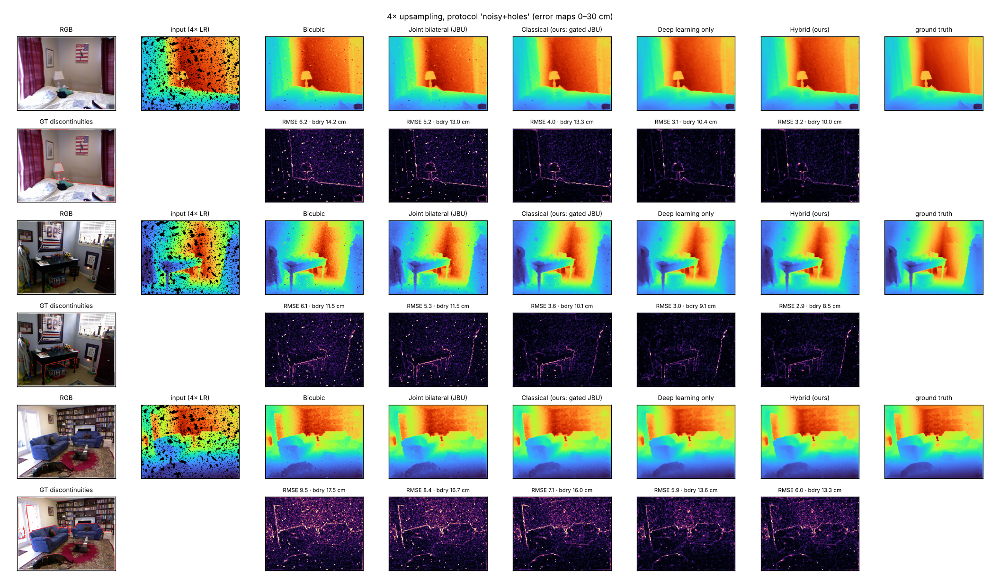
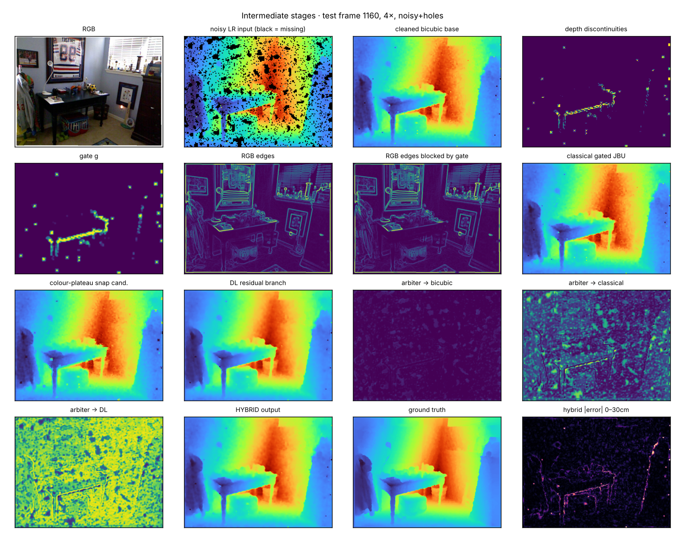
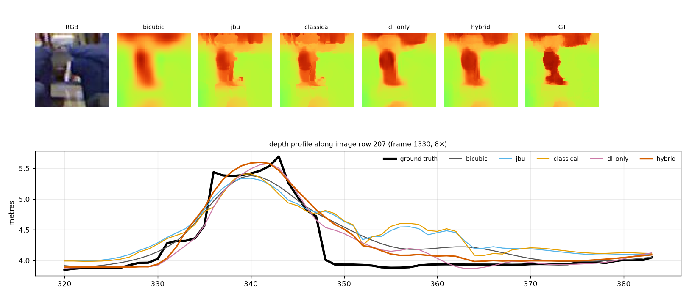

# Hackathon Technical Solution Report

| Field | Details |
| :---- | :---- |
| **Problem ID** | P4 |
| **Problem Title** | Edge-Preserving Depth Map Upsampling and Refinement |
| **Team Name** | Code Crushers |
| **Team Members** | Pratham Datta (1RUA24CSE0324); Rahul V KUMAR (1RUA24CSE0353); Rajath MS (1RUA24CSE0354) |
| **GitHub Repository** | https://github.com/PrathamDatta/HACKATHON_CV (branch `claude/practical-pasteur-0j1ipi`), commit `fe231ea` |
| **Live Demo / Deployment** | https://hackathoncv-s8pekuxnusulgddjwfqg8d.streamlit.app |

---

## 1. Problem Understanding & Solution Strategy

* **Core Technical Challenge:** Depth sensors such as the Kinect return depth maps that are low-resolution, noisy and incomplete, while the aligned colour camera is sharp and dense. The task is to reconstruct a dense high-resolution depth map (we test 2x, 4x and 8x upsampling) without destroying object boundaries and without copying colour texture into surfaces that are flat in depth. The failure modes we target are blurred or shifted depth edges (flying pixels), texture-copying artifacts from RGB-guided filters, noise amplification, and holes. Our corruption protocols add 2% multiplicative Gaussian noise with 0.5% spike outliers, and up to 20% missing pixels. The practical constraints are dense output at 640x480, boundary accuracy, reporting latency and memory, and a live demo that answers in roughly ten seconds on a free CPU host.
* **Proposed Methodology:** We combine a classical stage and a learned stage. The classical stage cleans the input depth, detects real depth discontinuities with a step detector, and lets the RGB image influence the result only near those discontinuities, which blocks texture copying. A U-Net then learns a residual correction (and, in the hybrid, a per-pixel blend between the safe bicubic estimate and the sharp classical estimate). We evaluate interpolation, classical, deep-only and hybrid variants on held-out frames; the best measured model is a larger deep-only network, while the hybrid wins only for the small models under noise and holes, so the system also includes a simple selector that picks a model from the measured noise and missing-value rate.

---

## 2. Technical Architecture & Implementation

> *Reference repository modules; no raw code in this report. Architecture diagram: `docs/architecture.png`.*



### 2.1 Classical Algorithmic Baseline

* **Algorithms Utilized:** Everything is in `depthup/classical.py`. We implement nearest, bilinear and bicubic interpolation as baselines; multi-scale normalised-convolution hole filling; a robust noise estimator (Immerkaer kernel with median absolute deviation); isolated-spike removal; joint bilateral upsampling with a spatially varying colour tolerance and a depth-consistency term; the guided filter of He et al.; a second-difference step detector that finds depth discontinuities on the low-resolution map (steps respond, sloped planes do not); and a gate map that spreads this evidence to the band where upsampling blur occurs. We also tried a colour-plateau snap that assigns each pixel near an edge to the nearer depth plateau by colour; it hurt accuracy on NYU's soft ground truth and is therefore used only as an input feature.
* **Adaptive Selection Logic:** Parameters follow image statistics. Bilateral smoothing is applied only when the estimated noise exceeds 1 cm, so clean input is left untouched. The discontinuity threshold grows with the upsampling factor (0.025 m per unit of scale), because a wall-floor crease produces a second difference of that order. The colour tolerance is tight at detected discontinuities and effectively infinite elsewhere, so RGB can only vote where depth already jumps. Filled (previously missing) samples receive a lower confidence weight than measured ones.

### 2.2 Deep Learning Pipeline

* **Model Architecture:** Both learned models use the same three-level U-Net with GroupNorm and GELU and a dilated bottleneck (dilations 2, 4, 8) to see wide context at 8x. The small version has 0.22 M parameters (width 16) and can be trained on a CPU; the large version has about 9 M parameters (width 64, three blocks per stage) and was trained on a GPU. We chose a compact U-Net because it is simple to explain, trains quickly, and gives residual prediction over bicubic with RGB guidance. The deep-only model takes RGB, the bicubic depth and the scale factor; the hybrid additionally receives the classical outputs.
* **Loss Functions & Training:** The loss is an L1 term weighted seven times on ground-truth depth discontinuities plus a gradient-matching L1 term, so edges are learned rather than averaged. Degradation is applied on the fly with random scale (2, 4, 8) and a mix of clean (50%), noisy (25%) and noisy-with-holes (25%) inputs. We use NYU Depth V2 with a contiguous split: the small models train on frames 0-799 and validate on 800-999; the large model trains on 0-949 and validates on 950-999; test frames 1000-1448 were never used for training, validation or tuning. The small models used AdamW with a cosine schedule for about 6,200 steps on a CPU; the large deep-only model ran 12,350 steps (batch 16, 256-pixel crops, bf16, exponential-moving-average weights) on a laptop GPU and reached a validation RMSE of 1.686 cm.

### 2.3 Hybrid Integration & Adaptive Mechanism

* **Fusion Strategy:** The hybrid output is E0 + beta (E1 - E0) + delta, where E0 is the bicubic estimate, E1 the classical gated estimate, beta a learned per-pixel blend in [0, 1] and delta a learned residual. With beta = 0 the output has the same form as the deep-only model (bicubic plus a learned residual), so the hybrid can represent that solution; training does not guarantee it matches it (on clean input the small hybrid ended slightly worse). An earlier design that mixed the experts with a softmax lost to deep-only, because a softmax can never give one expert full weight; it is kept as an evaluation arm (Hybrid v1) and was replaced by this form.
* **Decision Logic:** Noise suppression versus detail is handled in two places. In the classical stage the colour tolerance and the noise-adaptive smoothing depend on the estimated noise and the detected discontinuities. At the system level, a fixed rule (never looking at ground truth) selects the deep-only model for pristine input (no missing values, estimated noise below 1.2 cm) and the hybrid otherwise. In practice the learned blend beta is only weakly selective; most of the gain comes from the residual, which we report honestly in the ablation.

---

## 3. Experimental Benchmarks & Evaluation

*Dataset: NYU Depth V2, held-out test frames 1000-1448 (449 frames for `clean`, 150 for each noisy protocol). Depth units assumed (raw x 10 m). CPU latency measured at 480x640, 4 threads, on the team's laptop. Tables below are generated from `results/*.json` by `scripts/make_report_skeleton.py`.*

### 3.1 Quantitative Benchmarks

**Clean input, 4x upsampling**

| Approach / model variant | RMSE (cm) ↓ | MAE (cm) ↓ | PSNR (dB) ↑ | SSIM ↑ | Boundary RMSE (cm) ↓ | Edge F1 ↑ | CPU latency (ms) |
| :---- | :---: | :---: | :---: | :---: | :---: | :---: | :---: |
| Interpolation baseline (bicubic) | 4.61 | 1.54 | 42.10 | 0.984 | 13.6 | 0.740 | 1 |
| **Classical (ours): gated joint bilateral** | 4.77 | 1.43 | 41.79 | 0.985 | 14.2 | 0.909 | 323 |
| Deep learning only (small, 0.22 M params) | 2.77 | 1.06 | 46.37 | 0.993 | 7.8 | 0.950 | 99 |
| **Proposed hybrid (small)** | 2.92 | 1.09 | 45.90 | 0.992 | 8.3 | 0.945 | 430 |
| **Deep learning only, large (9 M params, GPU-trained)** | 1.69 | 0.65 | 50.56 | 0.997 | 4.7 | 0.989 | 2585 |

**Noisy input with 20% missing values, 4x upsampling**

| Approach / model variant | RMSE (cm) ↓ | MAE (cm) ↓ | PSNR (dB) ↑ | SSIM ↑ | Boundary RMSE (cm) ↓ | Edge F1 ↑ | CPU latency (ms) |
| :---- | :---: | :---: | :---: | :---: | :---: | :---: | :---: |
| Interpolation baseline (bicubic) | 8.90 | 4.50 | 34.47 | 0.912 | 19.3 | 0.560 | 1 |
| **Classical (ours): gated joint bilateral** | 6.37 | 3.17 | 37.76 | 0.958 | 17.1 | 0.686 | 323 |
| Deep learning only (small, 0.22 M params) | 5.48 | 2.53 | 39.07 | 0.974 | 15.0 | 0.861 | 99 |
| **Proposed hybrid (small)** | 4.72 | 2.34 | 40.39 | 0.979 | 12.8 | 0.863 | 430 |
| **Deep learning only, large (9 M params, GPU-trained)** | 3.82 | 1.88 | 42.23 | 0.986 | 10.4 | 0.928 | 2585 |

**RMSE (cm) across protocols and scales**

| Protocol | Scale | Interpolation baseline (bicubic) | Classical (ours): gated joint bilateral | Deep learning only (small, 0.22 M params) | Proposed hybrid (small) | Deep learning only, large (9 M params, GPU-trained) |
| :---- | :---: | :---: | :---: | :---: | :---: | :---: |
| clean | 2x | 2.56 | 2.86 | 1.76 | 1.75 | 0.95 |
| clean | 4x | 4.61 | 4.77 | 2.77 | 2.92 | 1.69 |
| clean | 8x | 7.69 | 7.69 | 4.98 | 5.17 | 3.43 |
| noisy | 2x | 6.71 | 4.06 | 2.51 | 2.54 | 1.88 |
| noisy | 4x | 7.53 | 5.33 | 3.71 | 3.64 | 2.77 |
| noisy | 8x | 9.20 | 7.57 | 5.70 | 5.73 | 4.35 |
| noisy+holes | 2x | 7.52 | 4.65 | 3.61 | 3.18 | 2.48 |
| noisy+holes | 4x | 8.90 | 6.37 | 5.48 | 4.72 | 3.82 |
| noisy+holes | 8x | 11.31 | 9.13 | 8.21 | 7.58 | 6.11 |

* **Analysis:** The large GPU-trained deep-only model has the lowest error in every protocol and scale (for example 3.43 cm RMSE at clean 8x against 7.69 cm for bicubic and 4.98 cm for the small deep-only model), but it needs about 2.6 s per image on a laptop CPU against about 0.1 s for the small model. The classical stage improves boundary sharpness (edge F1 at 8x rises from 0.45 to 0.76) but does not reduce RMSE on clean input. At small-model scale the hybrid is better than deep-only only under noise and missing values (for example 4.72 cm against 5.48 cm at 4x with holes) and slightly worse on pristine input; paired bootstrap intervals (in `eval_P4_*.md`) confirm both effects. The large hybrid and an ensemble were planned but not trained because of the deadline, so we cannot say whether classical features still help a large model.

### 3.2 Visual Outputs & Intermediate Representations









The first two figures compare every method on the same frames with error maps: the learned models show thinner error lines along object boundaries than bicubic and the classical stage, whose errors cluster along edges at 8x (these two figures use the small models). The stage figure shows the intermediate representations: the step detector fires on the table edge and a few noise spikes, the gate is concentrated around real discontinuities, RGB edges that the gate blocks cover texture such as the framed picture and the window blinds, and the learned residual is largest near boundaries. The boundary profile (small models, 8x) shows a depth profile across one image row: none of the methods reproduces the sharp ground-truth step, bicubic turns it into a ramp, the joint bilateral and classical estimates add an extra bump beside the object, and the learned models settle onto the lower depth plateau sooner but still smooth the step; thin objects are blurred by every method at this scale.

### 3.3 Ablation Study

*Small CPU-trained models, 80 test frames, 8x upsampling.*

**Clean input**

| Variant | RMSE (cm) | Boundary RMSE (cm) | Edge F1 | Texture-copy RMSE (cm) |
| :---- | :---: | :---: | :---: | :---: |
| bicubic | 7.93 | 23.2 | 0.46 | 2.68 |
| A  plain JBU (no gate, no depth term, no clean-up) | 7.83 | 22.6 | 0.76 | 2.73 |
| B  + depth-consistency term | 7.98 | 23.1 | 0.79 | 2.62 |
| C  + discontinuity gate (texture-copy suppression) | 7.94 | 23.2 | 0.76 | 2.57 |
| D  + noise-adaptive LR clean-up  (= Classical, ours) | 7.98 | 23.3 | 0.76 | 2.57 |
| E  D + hard colour-plateau snap | 13.42 | 36.6 | 0.71 | 5.17 |
| E0 only (bicubic) | 7.98 | 23.3 | 0.46 | 2.68 |
| E1 only (classical gated JBU) | 7.98 | 23.3 | 0.76 | 2.57 |
| learned blend β only (residual δ off) | 7.55 | 22.1 | 0.62 | 2.57 |
| residual δ only (β = 0) | 5.58 | 15.8 | 0.81 | 2.40 |
| full hybrid: E0 + β(E1−E0) + δ  (ours) | 5.41 | 15.3 | 0.84 | 2.32 |
| v1 softmax-convex arbiter (superseded) | 5.86 | 16.6 | 0.82 | 2.44 |
| deep learning only (no classical features) | 5.25 | 14.8 | 0.89 | 2.21 |

**Noisy input with missing values**

| Variant | RMSE (cm) | Boundary RMSE (cm) | Edge F1 | Texture-copy RMSE (cm) |
| :---- | :---: | :---: | :---: | :---: |
| bicubic | 13.28 | 31.2 | 0.43 | 7.95 |
| A  plain JBU (no gate, no depth term, no clean-up) | 12.24 | 29.5 | 0.66 | 7.30 |
| B  + depth-consistency term | 12.58 | 30.4 | 0.65 | 7.35 |
| C  + discontinuity gate (texture-copy suppression) | 12.62 | 30.4 | 0.63 | 7.37 |
| D  + noise-adaptive LR clean-up  (= Classical, ours) | 11.02 | 28.6 | 0.57 | 5.44 |
| E  D + hard colour-plateau snap | 13.91 | 35.8 | 0.56 | 6.72 |
| E0 only (bicubic) | 11.29 | 29.0 | 0.42 | 5.67 |
| E1 only (classical gated JBU) | 11.02 | 28.6 | 0.57 | 5.44 |
| learned blend β only (residual δ off) | 10.92 | 28.1 | 0.51 | 5.53 |
| residual δ only (β = 0) | 9.25 | 23.0 | 0.72 | 5.22 |
| full hybrid: E0 + β(E1−E0) + δ  (ours) | 9.09 | 22.7 | 0.73 | 5.13 |
| v1 softmax-convex arbiter (superseded) | 9.79 | 24.2 | 0.71 | 5.53 |
| deep learning only (no classical features) | 9.90 | 25.2 | 0.74 | 5.19 |

* **Interpretation:** The learned residual produces by far the largest RMSE drop (clean 8x: 7.98 to 5.58 cm; noisy with holes: 11.29 to 9.25 cm). Plain joint bilateral filtering supplies most of the edge-F1 gain. Adding the depth-consistency term and then the discontinuity gate lowers texture-copy error slightly on clean input (2.73 cm for plain JBU, 2.62 cm with the depth term, 2.57 cm with the gate as well, 2.68 cm for bicubic) and has no measurable effect under heavy noise. Noise-adaptive clean-up matters only for degraded input (12.62 to 11.02 cm RMSE with holes) and changes nothing on clean input. The hard colour-plateau snap hurts badly (7.98 to 13.42 cm clean) because NYU's inpainted ground truth has soft boundaries, so a wrong plateau assignment costs the full depth jump. The learned blend adds a further 2-3% on top of the residual, and the redesigned blend beats the first softmax version (5.41 vs 5.86 cm clean). Ablations were run on the small models.

---

## 4. Failure Modes & Limitations

* **Observed Failure Case:** The hardest test frame is 1015 (clean 8x, RMSE about 21.6 cm for the small hybrid versus 22.2 cm for bicubic): a dark corridor with a glass or mirror door. Errors concentrate on thin door frames and on the glass region. A second case is frame 1240 (noisy with holes, 4x), where missing samples fall exactly on large depth jumps. Across the test set, error correlates strongly with ground-truth edge density (Spearman 0.94) and depth range (0.89) and is essentially unrelated to image brightness (0.13) or local colour contrast (-0.01). We also saw isolated surviving noise spikes triggering the step detector and wrongly opening the gate.
* **Root Cause & Mitigation:** Thin structures narrower than one low-resolution cell are aliased away at 8x, so no method can recover them from the input; glass and reflections have depth unrelated to RGB structure, so guidance carries no information; and when holes cover a boundary there are no samples of one surface nearby. Spike-triggered false discontinuities could be removed by a connected-component size filter on the discontinuity map (a real step is a line, a spike is a point). Further mitigations are multi-scale evidence and a cross-dataset evaluation. Other limitations: the degradation is synthetic, the data are indoor Kinect scenes only, depth units are assumed (raw x 10 m), and the large hybrid was not trained.

---

## 5. Deployment & Quickstart Guide

### Quickstart Commands

```sh
git clone https://github.com/PrathamDatta/HACKATHON_CV
cd HACKATHON_CV
git checkout claude/practical-pasteur-0j1ipi
pip install -r requirements.txt
streamlit run app.py
```

### Deployment Format

* Streamlit dashboard deployed on Streamlit Community Cloud (CPU only); a `Dockerfile` is also provided for container deployment. The app is deployed from the GitHub branch to Streamlit Community Cloud (free CPU), where a reconstruction takes roughly 7-10 seconds with the default models; the large model and the intermediate-stage view are the slowest parts, and the app sleeps when idle.

---

## 6. AI Assistance Declaration

* **AI tool used:** Claude Code (Anthropic) was used throughout this project.
* **What the AI did:** designed and wrote the code in `depthup/` (classical methods, networks, training, evaluation, web app), ran the experiments and the ablation and failure analysis on a cloud CPU environment, generated the tables and figures from the result files, drafted the repository documentation, and **drafted the text of this report from the repository's results.**
* **What the team did:** `[TEAM TO WRITE truthfully, e.g. chose the problem, ran the GPU training on a laptop, deployed the app, reviewed and edited this report, prepared for the viva.]`
* **Authorship of this report's prose:** the prose of this report was drafted by the AI assistant and reviewed by the team `[TEAM: describe your review and any edits honestly]`. A majority of the text of this document is therefore AI-drafted.
* **Estimated AI share of this report's text:** `[TEAM TO FILL honestly]`

---

### Student Submission Checklist

- [ ] Working GitHub repository link included with an updated `README.md`.
- [ ] No raw code pasted into this report.
- [ ] All table metrics match test runs reproducible via the repository.
- [ ] All team member details accurately recorded.
